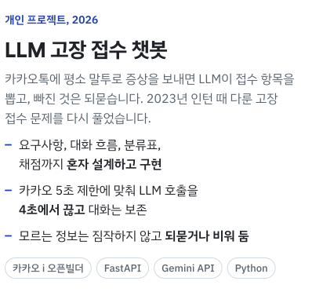
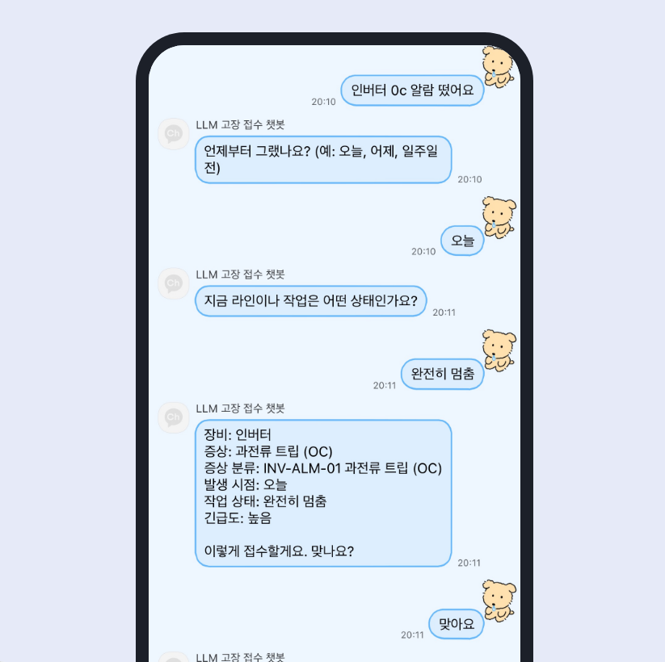
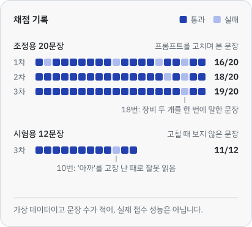
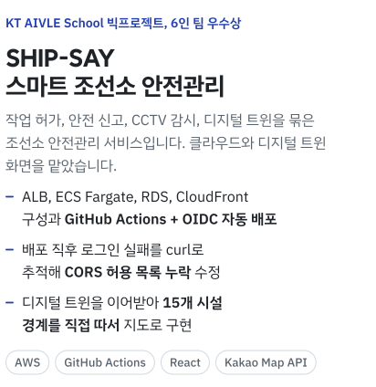
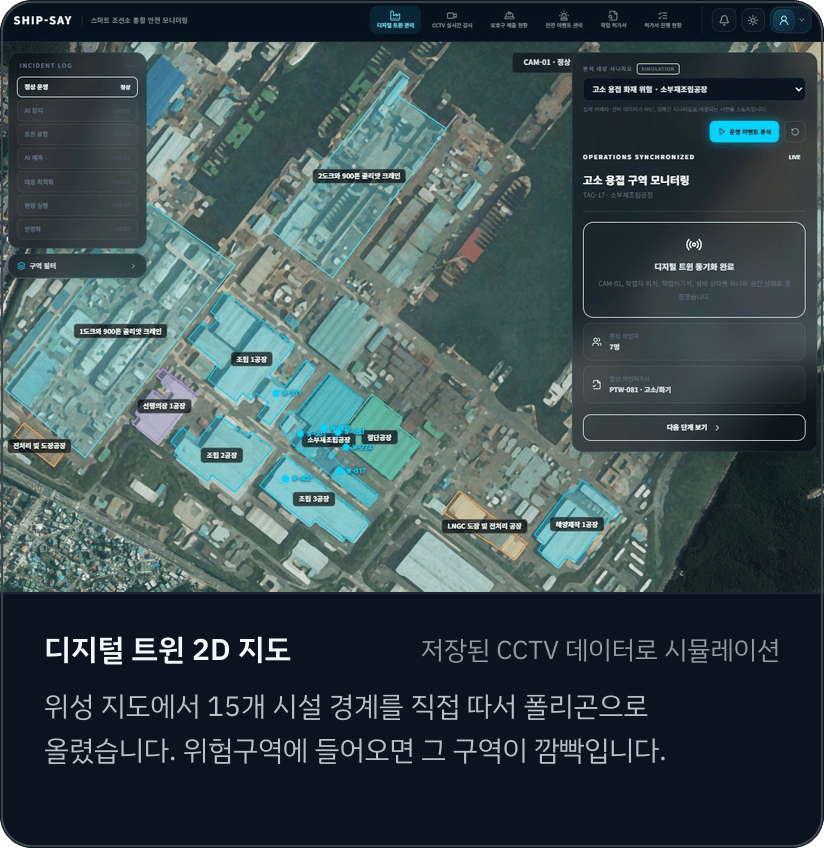
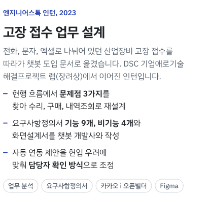
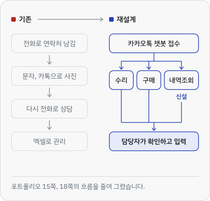

  <picture>
    <source media="(prefers-color-scheme: dark)" srcset="assets/hello-dark.svg">
    
  </picture>

  <a href="mailto:jjaehani@kakao.com">
    <picture>
      <source media="(prefers-color-scheme: dark)" srcset="assets/btn-email-dark.svg">
      
    </picture>
  </a>
  <a href="Resume_LeeJaehwan.pdf">
    <picture>
      <source media="(prefers-color-scheme: dark)" srcset="assets/btn-resume-dark.svg">
      
    </picture>
  </a>
  <a href="Portfolio_LeeJaehwan.pdf">
    <picture>
      <source media="(prefers-color-scheme: dark)" srcset="assets/btn-portfolio-dark.svg">
      
    </picture>
  </a>
  <a href="CV_LeeJaehwan.pdf">
    <picture>
      <source media="(prefers-color-scheme: dark)" srcset="assets/btn-cv-dark.svg">
      
    </picture>
  </a>

  <a href="https://github.com/jjaehani/llm-fault-intake">
    <picture>
      <source media="(prefers-color-scheme: dark)" srcset="assets/llm-dark.svg">
      
    <picture>
      <source media="(prefers-color-scheme: dark)" srcset="assets/llm-dark.png">
      
    </picture>
  </a>
  

  <a href="https://github.com/jjaehani/llm-fault-intake">
    <picture>
      <source media="(prefers-color-scheme: dark)" srcset="assets/demo-dark.svg">
      
    </picture>
  </a>
  <a href="https://github.com/jjaehani/llm-fault-intake/blob/main/docs/evaluation.md">
    <picture>
      <source media="(prefers-color-scheme: dark)" srcset="assets/record-dark.svg">
      
    </picture>
  </a>

  근거:
    <a href="https://github.com/jjaehani/llm-fault-intake/blob/main/docs/requirements.md">요구사항 정의서</a>,
    <a href="https://github.com/jjaehani/llm-fault-intake/blob/main/docs/evaluation.md">채점 기록</a>,
    <a href="https://github.com/jjaehani/llm-fault-intake/blob/main/src/dialog.py">대화 흐름 코드</a>
  

  <a href="https://github.com/jjaehani/KT-AIVLESCHOOL-BIGproj">
    <picture>
      <source media="(prefers-color-scheme: dark)" srcset="assets/shipsay-dark.svg">
      
    </picture>
  </a>
  

  근거:
    <a href="https://github.com/jjaehani/KT-AIVLESCHOOL-BIGproj/tree/main/infra">인프라 설계 기록</a>,
    <a href="https://github.com/jjaehani/KT-AIVLESCHOOL-BIGproj/blob/main/.github/workflows/deploy-backend.yml">배포 워크플로</a>,
    <a href="https://github.com/jjaehani/KT-AIVLESCHOOL-BIGproj/blob/main/frontend/src/components/digitalTwin/KakaoYardMap.jsx">지도 화면 코드</a>
  

  <a href="Portfolio_LeeJaehwan.pdf">
    <picture>
      <source media="(prefers-color-scheme: dark)" srcset="assets/engstok-dark.svg">
      
    </picture>
  </a>
  <a href="Portfolio_LeeJaehwan.pdf">
    <picture>
      <source media="(prefers-color-scheme: dark)" srcset="assets/flow-dark.svg">
      
    </picture>
  </a>

  회사 문서라 원본은 올리지 않았습니다. 분석과 설계 과정은 <a href="Portfolio_LeeJaehwan.pdf">포트폴리오 PDF</a> 14~20쪽에 있습니다.

