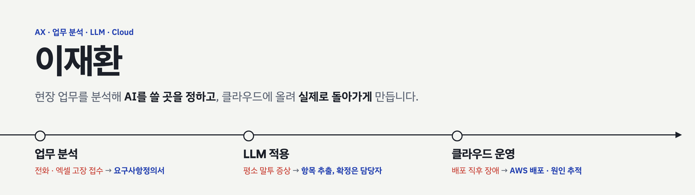

<picture>
  <source media="(prefers-color-scheme: dark)" srcset="assets/banner-dark.png">
  
</picture>

 

산업장비 고장 접수 업무를 분석해 챗봇 도입 문서를 썼고, 지금은 같은 문제를 LLM으로 다시 풀고 있습니다.
KT AIVLE School 빅프로젝트에서는 AWS 배포와 디지털 트윈 지도를 맡았습니다(팀 우수상).

📮 jjaehani@kakao.com · 📄 [포트폴리오 PDF](./포트폴리오_이재환.pdf)

 

## 대표 프로젝트

### [LLM 고장 접수 챗봇](https://github.com/jjaehani/llm-fault-intake) · 개인 프로젝트, 진행 중

카카오톡에서 평소 말투로 고장 증상을 보내면 LLM이 장비, 증상, 분류 코드, 발생 시점, 작업 상태를 뽑고, 빠진 항목은 되묻습니다. LLM이 정리한 내용은 초안이고, 확정은 담당자가 합니다.

- 요구사항 정의, 대화 흐름, 화면 설계, 증상 분류표, 채점 스크립트, 카카오톡 연결까지 혼자 설계하고 구현
- 카카오 5초 응답 제한에 맞춰 LLM 호출을 4초에서 끊고, 실패해도 대화가 이어지게 처리
- 가상 데이터 채점: 조정용 20문장 중 19개, 시험용 12문장 중 11개 통과 (문장 수가 적어 실제 성능은 아님)

`카카오 i 오픈빌더` `FastAPI` `Gemini API` `Python`

### [SHIP-SAY 스마트 조선소 안전관리](https://github.com/jjaehani/KT-AIVLESCHOOL-BIGproj) · KT AIVLE School 빅프로젝트, 6인, 우수상

작업 허가서, 안전 신고, PPE 점검, CCTV 감시, 디지털 트윈을 묶은 조선소 안전관리 웹 서비스입니다. 저는 클라우드와 디지털 트윈 화면을 맡았습니다.

- IAM 그룹 6개로 파트별 권한을 나누고, GitHub Actions와 OIDC로 프론트(S3, CloudFront)와 백엔드(ECR, ECS) 배포 자동화
- 배포 직후 로그인 실패를 개발자 도구와 curl로 추적해, CORS 허용 목록에 빠진 CloudFront 도메인을 백엔드 팀원과 추가
- 디지털 트윈 담당자가 그만둬 이어받아, Claude로 코드 구조를 파악한 뒤 3D 야드를 Kakao Map 2D 지도로 전환하고 15개 시설 경계를 직접 따서 GeoJSON으로 표시

`AWS` `GitHub Actions` `Docker` `React` `Kakao Map API`

### 엔지니어스톡 고장 접수 챗봇 · DSC 기업애로기술 해결프로젝트 랩(장려상) → 인턴

전화, 문자, 엑셀로 처리하던 고장 접수를 따라가 문제점 3가지를 정리하고, 업무를 수리, 구매, 내역조회 3갈래로 다시 설계했습니다. 요구사항정의서(기능 9개, 비기능 4개)와 화면설계서를 챗봇 개발사와 함께 썼고, 카카오 i 오픈빌더로 대화 시나리오를 구성했습니다. 챗봇 접수를 수리내역에 바로 넣자는 제안은 고객 오입력을 걱정한 대표 의견에 따라 담당자 확인 방식으로 바꿨습니다.

 

## AI와 일하는 방식

| AI에 맡긴 것 | 직접 정한 것 | 직접 확인한 것 |
|---|---|---|
| 처음 보는 코드의 모듈 구조 정리, 작업량 비교 초안 | 구현 범위와 우선순위 | 실행 화면, 로그, 채점 결과 |

LLM 결과는 초안으로 두고, 틀렸을 때 누가 고치는지부터 정합니다.

 

## 기술

| 분야 | 써 본 것 |
|---|---|
| AI · LLM | Gemini API, YOLO(v4-tiny, v5x), Claude |
| 백엔드 · 데이터 | Python, FastAPI, MySQL, MariaDB, Selenium |
| 클라우드 | AWS(IAM, EC2, ECR, ECS, RDS, S3, CloudFront, Secrets Manager), Docker, GitHub Actions |
| 화면 · 기획 | React, Kakao Map API, Figma, 카카오 i 오픈빌더, 요구사항정의서, 화면설계서 |

 

## 경력과 교육

| 기간 | 내용 |
|---|---|
| 2026.03 – 2026.09 | KT AIVLE School AI 트랙 수료 (840시간), 빅프로젝트 우수상 |
| 2023.07 – 2023.08 | 엔지니어스톡 인턴: 고장 접수 업무 분석과 챗봇 설계 문서 |
| 2023.01 – 2023.02 | 충남정보문화산업진흥원 인턴: DB 설계, SKT 데이터 약 6,000만 건 이관과 검증 |
| 2022.09 – 2022.12 | 아이와즈 인턴: 웹하드 침해 조사, Selenium 크롤러, AI 학습 데이터 태깅 |
| 2020.03 – 2024.02 | 배재대학교 사이버보안학과, DSC 공유대학 모빌리티 SW/AI 융합전공 |
